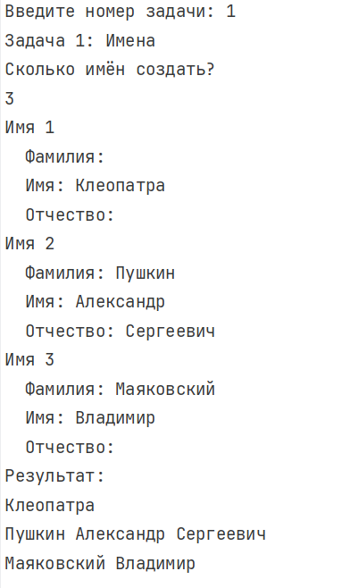
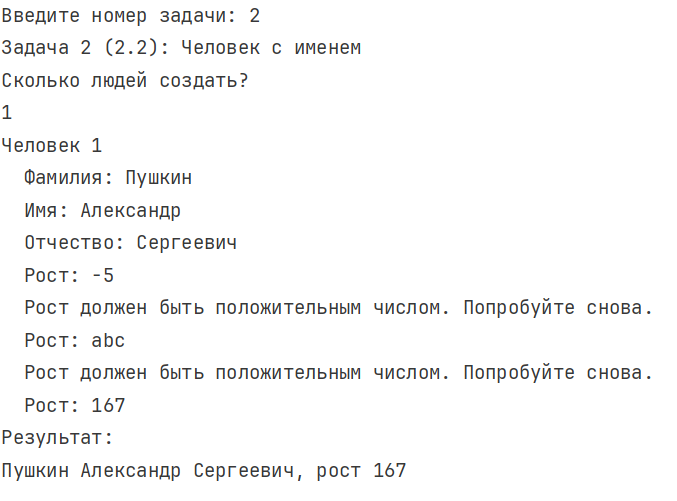
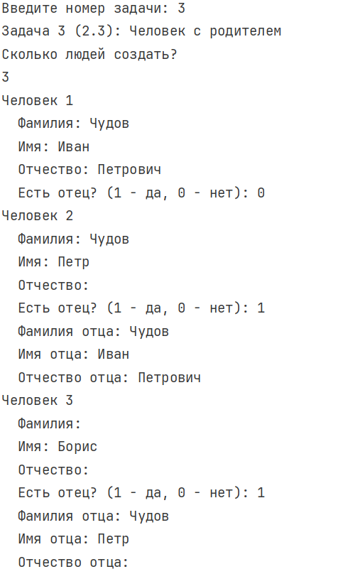
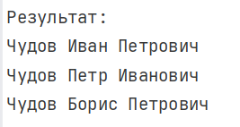
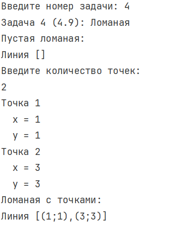
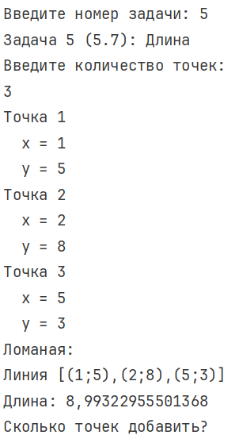
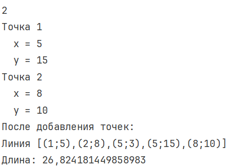

---

# Лабораторная работа №2

**Салабай Даниил, ИТ-2, 10 Вариант**

---

## Задание 1. Задача 1

### Текст задачи

**Имена.**

Создайте сущность Имя, которая описывается тремя параметрами: Фамилия, Личное имя, Отчество. Имя может быть приведено к строковому виду, включающему традиционное представление всех трех параметров: Фамилия Имя Отчество (например “Иванов Иван Иванович”). Необходимо предусмотреть возможность того, что какой-либо из параметров может быть не задан, и в этом случае он не учитывается при приведении к текстовому виду.

Необходимо создать следующие имена:

- Клеопатра
- Пушкин Александр Сергеевич
- Маяковский Владимир

Обратите внимание, что при выводе на экран, не заданные параметры никак не участвуют в образовании строки.

### Алгоритм решения

1. Создать класс Name с тремя строковыми полями для фамилии, личного имени и отчества.
2. Добавить конструктор, принимающий фамилию и имя, а отчество сделать необязательным параметром со значением пустой строки.
3. Создать свойства LastName, FirstName и MiddleName для доступа к данным объекта.
4. Реализовать ToString: добавлять в результат только непустые части имени.
5. В Main запросить у пользователя количество имён и данные каждого имени, затем вывести их через Console.WriteLine.

### Создаваемые поля и их назначение

| Поле | Тип | Назначение |
|------|-----|------------|
| lastName | string | Хранит фамилию; может быть пустой. |
| firstName | string | Хранит личное имя; может быть пустым. |
| middleName | string | Хранит отчество; необязательное значение. |

### Методы и свойства

- Конструктор `Name(...)` задаёт значения трёх полей.
- Свойства возвращают значения полей; `LastName` и `MiddleName` также имеют `set`.
- `ToString()` собирает строковое представление имени без пропущенных параметров.

### Тестирование



---

## Задание 2. Задача 2.2

### Текст задачи

**Человек с именем.**

Объедините сущности Человек из задачи 1.2 и Имя из задачи 1.3 таким образом, чтобы имя человека задавалось с использованием сущности 1.3, а не строки.

Необходимо объединить ранее созданные объекты имен и людей, с получением:

- Человека с Именем Клеопатра и ростом 152
- Человека с Именем Пушкин Александр Сергеевич ростом 167
- Человека с Именем Маяковский Владимир и ростом 189

### Алгоритм решения

1. Расширить модель данных классом Human.
2. Добавить в Human поле name типа Name и поле height типа int.
3. Создать конструктор `Human(Name name, int height)`, чтобы человек получал готовый объект имени, а не строку.
4. Добавить свойства Name и Height.
5. Переопределить ToString для вывода имени и роста.
6. В Main запросить у пользователя количество людей и данные каждого человека (ФИО и рост).
7. Рост вводится с проверкой: должен быть положительным числом.

### Создаваемые поля и их назначение

| Поле | Тип | Назначение |
|------|-----|------------|
| name | Name | Связывает человека с объектом, описывающим его имя. |
| height | int | Хранит рост человека. |
| father | Human | Зарезервировано для следующей задачи; у человека без родителя равно null. |

### Методы и свойства

- Конструктор `Human(Name, int)` сохраняет имя и рост.
- Свойство Name возвращает объект Name, а Height возвращает рост.
- `ToString()` объединяет строковое представление Name и значение Height.

### Тестирование



---

## Задание 2. Задача 2.3

### Текст задачи

**Человек с родителем.**

Измените сущность Человек из задачи 2.2 добавив ему возможность задавать третий параметр: Отец, где Отец — это тоже Человек. При приведении человека к строковой форме необходимо проверить параметры имени, и в зависимости от ситуации выполнить одно из следующих действий:

- Если у данного человека нет фамилии, и есть отец, у которого фамилия задана, то фамилию необходимо сделать такой же как у отца.
- Если у данного человека нет отчества, а у отца есть имя, то необходимо задать отчество как имя отца с добавлением суффикса “ович”.

Затем необходимо выполнить следующие задачи:

1. Создать людей: Чудова Ивана, Чудова Петра, Бориса
2. Сделать Ивана отцом Петра, а Петра отцом Бориса
3. Вывести на экран строковое представление всех троих людей.

### Алгоритм решения

1. Добавить третье поле father типа Human.
2. Сохранить два конструктора: без отца и с отцом.
3. В ToString проверить фамилию: если она пустая, взять фамилию отца.
4. В ToString проверить отчество: если оно пустое, добавить имя отца и суффикс «ович».
5. В Main запросить у пользователя количество людей и данные каждого.
6. Отец задаётся вводом ФИО — программа ищет его среди уже созданных людей.
7. Если отец не найден, человек создаётся без отца.
8. Рост в этой задаче не вводится и не выводится.

### Создаваемые поля и их назначение

| Поле | Тип | Назначение |
|------|-----|------------|
| father | Human | Хранит ссылку на объект отца; используется для наследования фамилии и образования отчества. |

### Методы и свойства

- Конструктор `Human(Name, int, Human)` создаёт человека с указанным отцом.
- Father возвращает объект отца.
- `ToString()` выполняет проверки имени перед выводом.
- `FindFather` — вспомогательный метод поиска отца по ФИО среди уже созданных людей.

### Тестирование



---

## Задание 4. Задача 4.9

### Текст задачи

**Создаем Ломаную.**

Измените сущность Ломаная из задачи 1.3.2. Новые требования включают:

- Ломаная может быть создана без указания каких-либо параметров
- Ломаная может быть создана с указанием некоторого набора Точек

### Алгоритм решения

1. Создать класс Point с координатами x и y.
2. Создать класс Polyline с массивом точек points.
3. Добавить конструктор без параметров, создающий пустую ломаную.
4. Добавить конструктор `Polyline(Point[] points)` для создания ломаной по готовому массиву.
5. Реализовать Points и ToString для доступа к точкам и вывода ломаной.
6. В Main создать пустую ломаную, затем прочитать точки с клавиатуры и создать ломаную с точками.

### Создаваемые поля и их назначение

| Поле | Тип | Назначение |
|------|-----|------------|
| x, y | double | Координаты точки на плоскости. |
| points | Point[] | Массив точек, задающий ломаную. |

### Методы и свойства

- `Point(double x, double y)` задаёт координаты.
- `Polyline()` создаёт массив `Point[0]`.
- `Polyline(Point[] points)` сохраняет переданный набор точек.
- `ToString()` проходит по массиву и формирует строку `Линия [...]`.

### Тестирование



---

## Задание 5. Задача 5.7

### Текст задачи

**Длина Ломаной.**

Измените сущность Ломаная из задачи 4.9. Новые требования включают:

- В любой момент к имеющимся Точкам можно добавить новые Точки (добавляется либо массив, либо просто перечень Точек, что приводит к получению нового массива, содержащего как старые, так и новые значения).
- Может возвращать общую длину Ломаной.

Необходимо выполнить следующие задачи:

1. Создать Ломаную, проходящую через точки {1;5}, {2;8}, {5;3}
2. Вывести на экран её длину
3. Добавить (к ранее созданной Ломаной) точки {5;15}, {8;10}
4. Снова вывести на экран длину Ломаной

### Алгоритм решения

1. Использовать готовую ломаную с массивом точек.
2. Для AddPoint создать новый массив на одну позицию больше.
3. Перенести в новый массив старые точки и записать новую точку в последнюю ячейку.
4. Для AddPoints последовательно вызвать AddPoint для каждой точки нового массива.
5. В GetLength пройти по соседним парам точек, вычислять dx и dy, а затем длину отрезка по формуле √(dx² + dy²).
6. Сложить длины всех отрезков и вывести результат до и после добавления точек.

### Создаваемые поля и их назначение

| Поле | Тип | Назначение |
|------|-----|------------|
| points | Point[] | Текущие точки ломаной, к которым добавляются новые значения. |
| length | double | Локальная переменная для накопления общей длины. |

### Методы и свойства

- `AddPoint(Point)` добавляет одну точку через создание расширенного массива.
- `AddPoints(Point[])` добавляет несколько точек.
- `GetLength()` возвращает сумму расстояний между соседними точками.
- `ToString()` позволяет проверить состав ломаной до и после изменения.

### Тестирование




```
